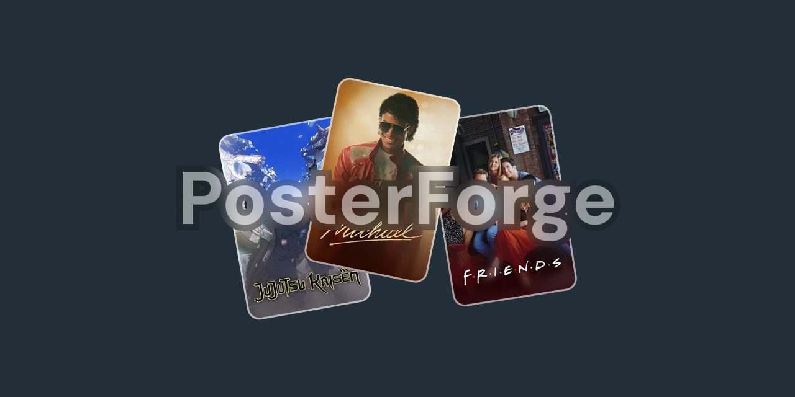

# PosterForge for Jellyfin

<p align="center">
  
</p>


**PosterForge** gives your whole library one polished, consistent look. Set it as your main image provider and every movie, series and season gets a matching poster automatically: clean artwork, a soft blurred and shaded base, a crisp title logo, and frosted season titles.

## ✨ Features

* **One consistent style everywhere:** movies, series and seasons all share the same design, so your library looks like it belongs together.
* **Fully automatic:** as your main image provider, new and refreshed titles get their poster without you lifting a finger.
* **Season artwork that stands out:** the series logo sits above a large, frosted-glass season title, with an extra soft blur behind it.
* **Your language:** season titles follow the series' metadata language: "Season 1", "Seizoen 1", "Saison 1" and so on.
* **Clean, textless art:** posters are chosen without baked-in text, so the title is always crisp and the same.
* **Always something to show:** no logo available? The title is printed as clean text instead.
* **Your choice, any time:** open **Edit Images** on any title to pick a different variant.

---

## 📥 Installation

### Step 1: Add the repository
1. Open the **Jellyfin Web UI** as an administrator.
2. Go to **Dashboard** → **Plugins** → **Repositories** → **(+) Add**.
3. Enter:
   * **Repository Name:** PosterForge
   * **Repository URL:** `https://raw.githubusercontent.com/sanderdelanghe/PosterForge-jellyfin/main/manifest.json`
4. Click **Save**.

### Step 2: Install the plugin
1. Switch to the **Catalog** tab and find **PosterForge** under **Metadata**.
2. Choose the latest version and click **Install**.
3. **Restart Jellyfin.** The plugin does not load until the server has restarted.

---

## ⚙️ Configuration

Go to **Dashboard** → **Plugins** → **PosterForge**.

| Setting | What it does |
| --- | --- |
| **TMDB API key** | Required. A free key from [themoviedb.org/settings/api](https://www.themoviedb.org/settings/api). |
| **Fanart.tv API key** | Optional. Adds extra artwork when TMDB has none. Get one at [fanart.tv/get-an-api-key](https://fanart.tv/get-an-api-key/). |
| **Server URL** | How Jellyfin reaches itself, default `http://127.0.0.1:8096`. Include your base path if you use one. |
| **Poster blur / Season blur** | Blur strength at the bottom of the artwork, in pixels (default 40 / 60). |
| **Font family** | Font for title text, default `DM Sans`. It must be installed on the server, otherwise a default bold font is used. |

---

## 🚀 Make it your main provider

1. Go to **Dashboard** → **Libraries** and open your Movies or TV Shows library.
2. Under **Image fetchers**, drag **PosterForge** to the top.
3. Click **Save**, then choose **Scan Library** → **Replace all metadata** with **Replace existing images** checked.

From now on, every new or refreshed title gets a PosterForge poster.

### Picking a different variant
1. Open a movie, series or season → **3-dot menu** → **Edit Images**.
2. Click the **search (magnifying glass)** icon next to *Primary*.
3. Choose a **PosterForge** poster and click the download icon.

Titles need a TMDB ID in their metadata. If a title has none, refresh its metadata first.

---

## 🛠️ Troubleshooting

* **No PosterForge posters appear:** check that the TMDB key is set and that the item has a TMDB ID.
* **Posters fail to download:** check that **Server URL** works from the Jellyfin server itself.
* **Title text looks too light:** install the DM Sans ExtraBold font on the server, or enter another installed font.
* **Plugin page is blank:** restart Jellyfin after installing, then hard-refresh the page (`Ctrl + Shift + R`).

---

## 🧱 Building from source

Requires the .NET 10 SDK.

```
dotnet publish Jellyfin.Plugin.PosterForge -c Release
```

---

## 📝 Credits

Made by **Sander De Langhe** (Using AI Assistance). Artwork comes from [TMDB](https://www.themoviedb.org/) and [Fanart.tv](https://fanart.tv/). *This product uses the TMDB API but is not endorsed or certified by TMDB.* This is an unofficial community plugin and is not affiliated with Jellyfin.
